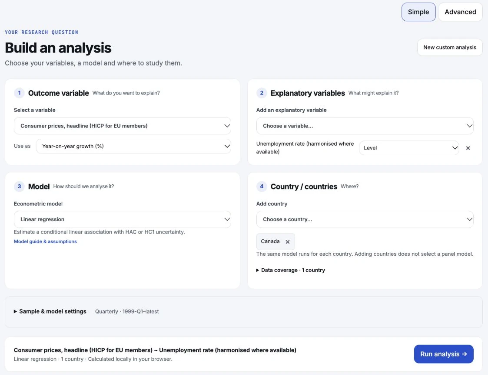
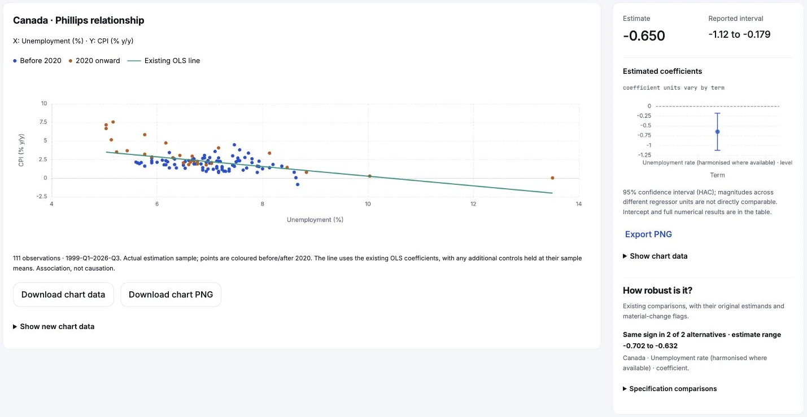
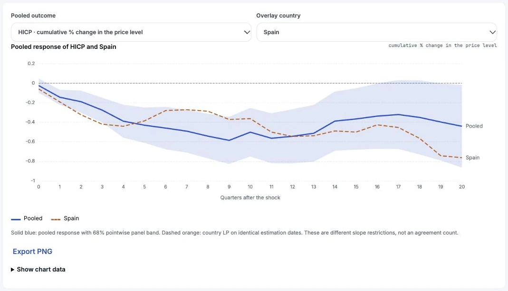

# MacroLab

Version 2.6.4.

Explore official macroeconomic data and econometric models in your browser. For students, researchers and teaching, with assumptions and data gaps in view.

[Open MacroLab](https://hakangulmez.github.io/macrolab/) · [Methods and documentation](https://hakangulmez.github.io/macrolab/#methods) · [Data licences](DATA.md)

## Build an analysis

Choose your **outcome variable → explanatory variables → model → country or countries**, then select **Run analysis**. The variable labels adapt to forecasts, systems and shock analysis.

<picture>
  <source media="(prefers-color-scheme: dark)" srcset="docs/images/builder-dark.webp">
  <source media="(prefers-color-scheme: light)" srcset="docs/images/builder-light.webp">
  
</picture>

**Simple** keeps sample and technical settings collapsed. **Advanced** opens those same settings and preserves your choices. You can also start from one of **9 reviewed templates** or the five question types on Explore.

The first analysis may take a few extra seconds while the browser prepares the calculation engine. No account is required.

## What you can do

<!-- Counts verified against the shipped manifest; provenance in docs/README_MANIFEST.json. -->

- Explore **39 economies × 36 indicators**: 33 national concepts and 3 shared global factors. Coverage, gaps and official source citations stay attached to each series.
- Use **25 validated methods in 8 families**, from descriptive analysis and regression to panel models, shock analysis and forecasting.
- Inspect charts, estimates, intervals and the **Econometric specification**. Longer tables, sensitivity checks and technical notes open when needed.
- Take a selected series from Data into comparison, stationarity tests or regression. Missing inputs remain visible and block execution.
- Export **CSV, PNG, LaTeX tables and reproducible Python scripts**. Use either light or dark mode.

Calculations run locally through **Pyodide**, using the bundled snapshot. The published app does not request new data from providers or send your analysis to an analysis server.

## Results at a glance

### Inflation and unemployment

Canada's Phillips template places the observed relationship beside the coefficient interval and descriptive robustness summary. The line is the existing OLS fit; the relationship is an association, not a causal estimate.

<picture>
  <source media="(prefers-color-scheme: dark)" srcset="docs/images/workspace-current-dark.webp">
  <source media="(prefers-color-scheme: light)" srcset="docs/images/workspace-current-light.webp">
  
</picture>

### One ECB shock, country responses

Run **Same ECB shock · pooled**, then choose **Spain** in the overlay selector. The pooled and country responses use identical estimation dates. The panel band is conditional on the estimated shock and omits first-stage shock-estimation uncertainty.

<picture>
  <source media="(prefers-color-scheme: dark)" srcset="docs/images/ecb-current-dark.webp">
  <source media="(prefers-color-scheme: light)" srcset="docs/images/ecb-current-light.webp">
  
</picture>

These featured captures show the published v2.6.4 interface. Images follow your colour-scheme preference. [Capture versions, provenance and image sizes](docs/images/README.md).

<details>
<summary>More screenshots: data, forecasting and mobile</summary>

The earlier captures below retain their original version labels: Home and Data are from v2.5.0; the result views are from v2.6.0. They use the same accepted data snapshot.

### Explore the snapshot

Home compares inflation across economies. In Data, Germany's HICP cell shows its observations, coverage and source citation together.

<picture>
  <source media="(prefers-color-scheme: dark)" srcset="docs/images/home-dark.webp">
  <source media="(prefers-color-scheme: light)" srcset="docs/images/home-light.webp">
  
</picture>

<picture>
  <source media="(prefers-color-scheme: dark)" srcset="docs/images/dataset-dark.webp">
  <source media="(prefers-color-scheme: light)" srcset="docs/images/dataset-light.webp">
  
</picture>

### Türkiye exchange-rate pass-through

The cumulative CPI-to-NEER response ratio is the headline measure. It is a conditional association, not a causal estimate.

<picture>
  <source media="(prefers-color-scheme: dark)" srcset="docs/images/turkiye-dark.webp">
  <source media="(prefers-color-scheme: light)" srcset="docs/images/turkiye-light.webp">
  
</picture>

### Compare forecasting models

Euro-area inflation forecasts are evaluated against a random-walk benchmark. RMSE by horizon compares models on matched forecast origins within each horizon; this uses final-vintage data and is not a claim about future performance.

<picture>
  <source media="(prefers-color-scheme: dark)" srcset="docs/images/horse-race-dark.webp">
  <source media="(prefers-color-scheme: light)" srcset="docs/images/horse-race-light.webp">
  
</picture>

<picture>
  <source media="(prefers-color-scheme: dark)" srcset="docs/images/horse-race-rmse-dark.webp">
  <source media="(prefers-color-scheme: light)" srcset="docs/images/horse-race-rmse-light.webp">
  
</picture>

### Additional Phillips view

Canada's recorded inflation and unemployment observations, split before and after 2020, with the existing fitted line.

<picture>
  <source media="(prefers-color-scheme: dark)" srcset="docs/images/phillips-dark.webp">
  <source media="(prefers-color-scheme: light)" srcset="docs/images/phillips-light.webp">
  
</picture>

### Mobile

Home at 375 CSS pixels (v2.5.0):

<picture>
  <source media="(prefers-color-scheme: dark)" srcset="docs/images/home-mobile-dark.webp">
  <source media="(prefers-color-scheme: light)" srcset="docs/images/home-mobile-light.webp">
  
</picture>

Pooled ECB result at 375 CSS pixels (v2.6.0):

<picture>
  <source media="(prefers-color-scheme: dark)" srcset="docs/images/ecb-pooled-mobile-dark.webp">
  <source media="(prefers-color-scheme: light)" srcset="docs/images/ecb-pooled-mobile-light.webp">
  
</picture>

</details>

## Who it's for

MacroLab supports research exploration, teaching and checks of how results depend on samples and assumptions. It does not replace a study's identification strategy or expert judgement.

## How results are validated

Calculations are cross-checked against reference implementations and independent formulas, with stated tolerances. Simulations examine bias and interval coverage; frozen native/browser regressions and export checks detect unintended changes. Passing these checks does not validate an economic interpretation. See [method validation](docs/VALIDATION.md) and the [method guide](docs/METHODS.md).

## Templates

| Template                                | Question                                                                                 | Method                         | Default countries                            |
| --------------------------------------- | ---------------------------------------------------------------------------------------- | ------------------------------ | -------------------------------------------- |
| Monetary policy                         | How do output and prices respond to a recursive US policy-rate shock?                    | VAR · Recursive                | United States                                |
| Taylor rule                             | How is the policy rate associated with inflation and activity?                           | OLS · HAC                      | United Kingdom                               |
| Phillips curve                          | How does the inflation–unemployment relationship vary across samples?                    | OLS · Rolling                  | Canada                                       |
| Okun's law                              | How are output growth and unemployment changes related?                                  | OLS · HAC                      | Spain                                        |
| Same ECB shock                          | How do national responses differ after the same ECB shock?                               | Local projections · HC1        | Germany, France, Italy, Spain                |
| Türkiye exchange-rate pass-through      | How much exchange-rate depreciation passes through to prices?                            | Local projections · HC1        | Türkiye                                      |
| Euro-area Phillips curve · pooled       | What inflation–slack relationship emerges when euro-area countries are pooled?           | Panel FE · Driscoll–Kraay      | 11 founding euro-area members (listed below) |
| Same ECB shock · pooled                 | What is the pooled response to the same ECB shock?                                       | Panel LP · Driscoll–Kraay      | Germany, France, Italy, Spain                |
| Euro-area inflation forecast horse race | Which model predicts euro-area inflation most accurately in expanding-window evaluation? | Forecast · RW, AR, ARIMA, BVAR | Euro area                                    |

The founding-member panel comprises Austria, Belgium, Finland, France, Germany, Ireland, Italy, Luxembourg, Netherlands, Portugal, Spain.

## Data

The **20261024-2040** snapshot contains **1,404 economy–indicator cells: 1,333 populated and 71 missing**. Shared global factors appear for each economy; cells are not distinct underlying source series.

| Coverage status                                     | Cells |
| --------------------------------------------------- | ----: |
| Available                                           |   521 |
| Available with a source or methodological note      |   695 |
| Limited history, freshness or modelling suitability |   117 |
| Missing                                             |    71 |

The 7 official sources are **OECD, BIS, IMF, ECB, Eurostat, World Bank WDI and U.S. EIA**. Each series carries attribution and coverage notes. **IMF data are included for non-commercial use; Pink Sheet is excluded.** See [DATA.md](DATA.md) for source-specific permissions and restrictions. Country narratives remain withheld.

MacroLab is a **non-commercial research and teaching tool**. Source revisions and data freshness can affect results; the bundled snapshot does not update while you browse.

## How to read results

- **Only forecasting outputs are forecasts.** Other outputs are conditional associations or identified scenarios, not forecasts.
- Forecast evaluation is **pseudo-out-of-sample with final-vintage data**; real-time performance may be worse.
- **Two-sided HP gaps use later observations.** They are retrospective measures.
- **Pooled shock bands omit first-stage estimation uncertainty.** Their precision is conditional on the estimated shock.
- **ECB break-test size remains unreliable.** Do not treat its p-values as well-calibrated evidence.
- Sensitivities are descriptive; they do not remove identification or model uncertainty. Different estimands are not combined in one agreement count.

## Limitations and roadmap

Shock identification is currently recursive: the ordering supplies the contemporaneous restrictions. MacroLab does not include high-frequency or external-instrument shock series such as EA-MPD. The bundled data are a fixed snapshot, not a live feed.

A future extension under consideration is an LLM-based view of monthly hawkish/dovish signals in ECB, Fed and other central-bank communications. It is not available in this release; communication scores would not by themselves identify monetary-policy shocks.

## Run locally and reproduce

Use Python 3.11, `uv`, and a Node version supported by `web/package.json`. Python and JavaScript dependencies are pinned in `uv.lock` and `web/package-lock.json`.

```sh
make setup
make quick
make test typecheck
make lint
# Compile the interface source:
cd web && npm run build
```

`make setup` retrieves dependencies from PyPI/npm with automatic Python downloads and npm lifecycle scripts disabled. `make quick` uses seeded synthetic data without network. Snapshot-dependent checks skip if their inputs are absent. The source repository does not bundle raw data, runtime binaries or private review evidence; compiling the interface alone does not prepare a runnable data snapshot.

For a self-contained calculation, download the result's **Python script**, follow its embedded environment instructions and run it locally. It carries the configuration, required input and provenance for that result. See [local build and reproduction](docs/LOCAL_BUILD.md) for the static-site inputs and [model validation cards](docs/models/README.md) for methods and limits. First-use runtime preparation takes about 8–9 seconds on the review machine; later runs reuse the worker.

## Citation

Hakan Zeki Gülmez (2026). _MacroLab_, version 2.6.4. https://github.com/hakangulmez/macrolab.

Machine-readable citation: [CITATION.cff](CITATION.cff). No DOI has been assigned.

## Licence

Code: [MIT](LICENSE). **Data and data-derived outputs are not covered by the MIT licence; see [DATA.md](DATA.md).** Fonts use the SIL Open Font License (OFL); other software retains its own terms. See [software notices](docs/SOFTWARE_NOTICES.md) and [runtime notices](third_party/runtime/SOURCE_AVAILABILITY.md).
