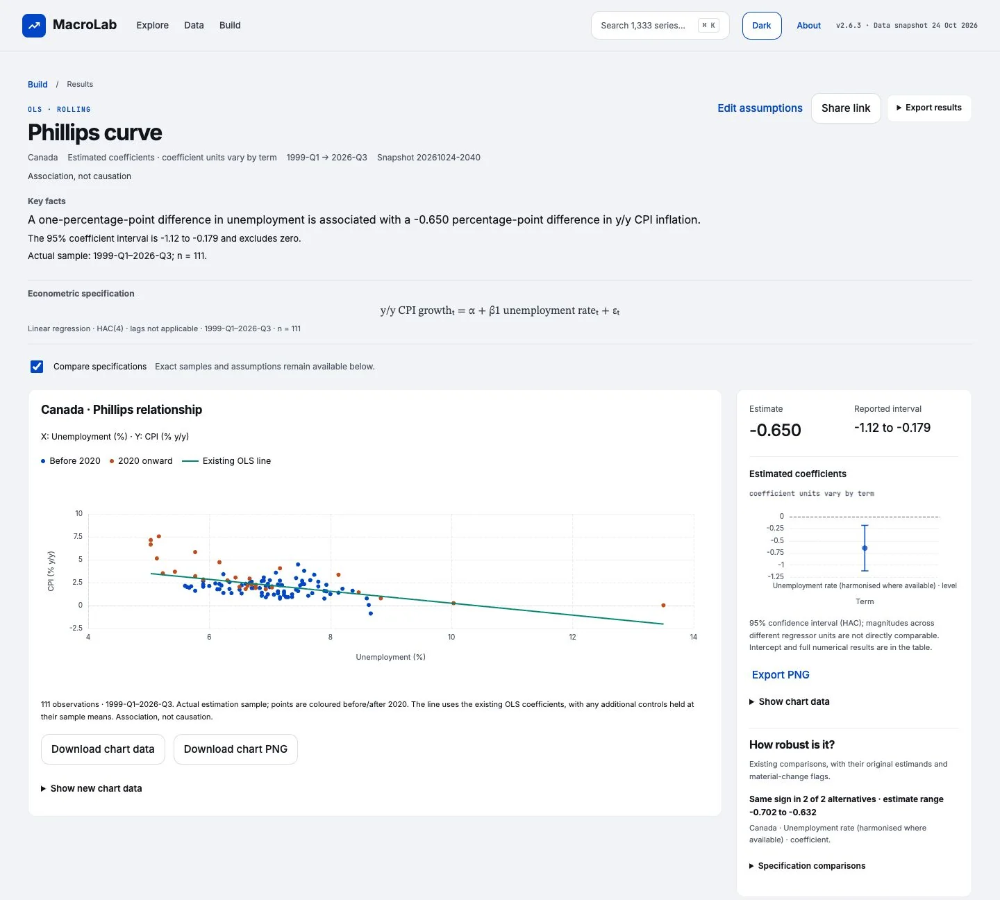
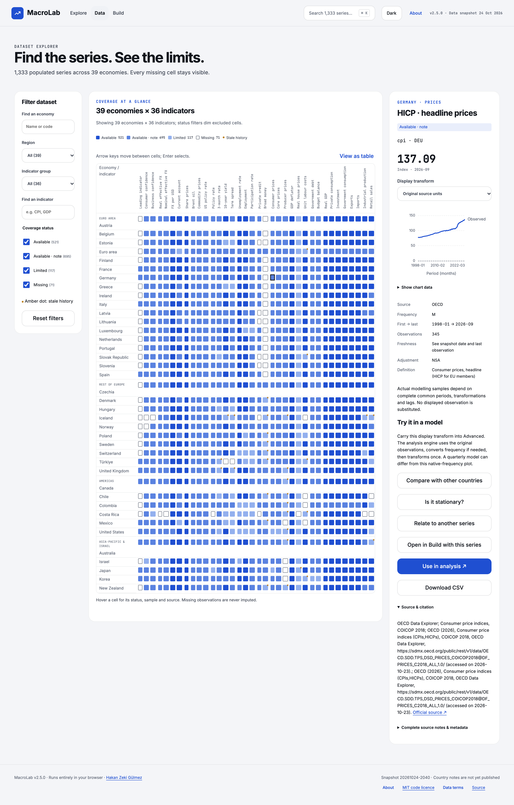
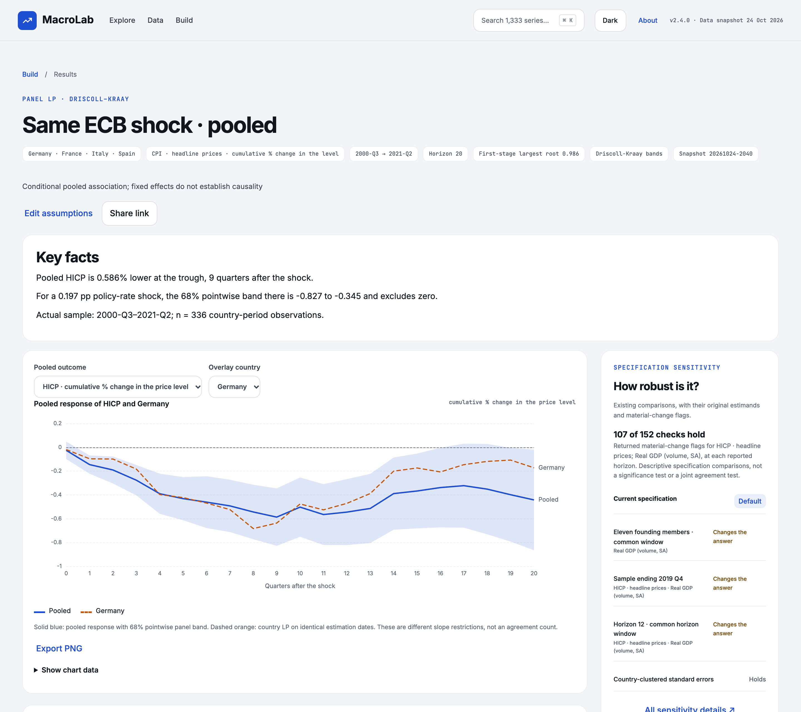
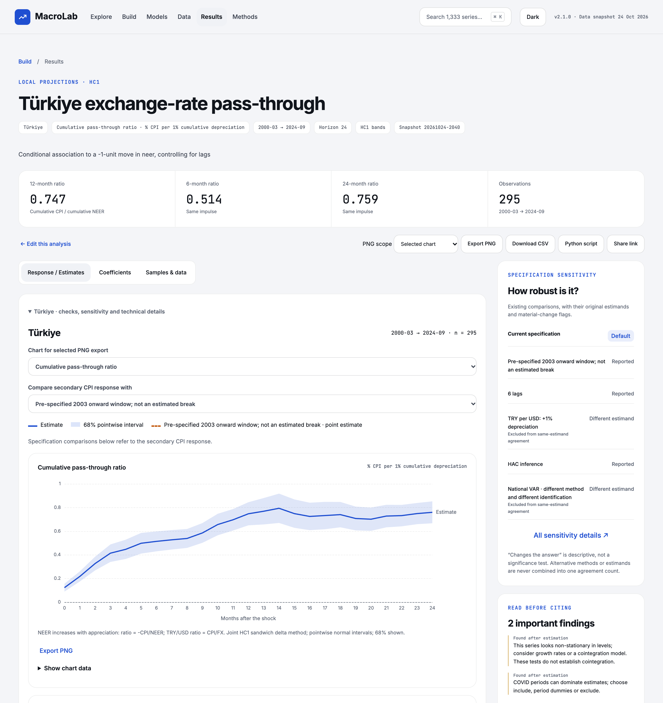
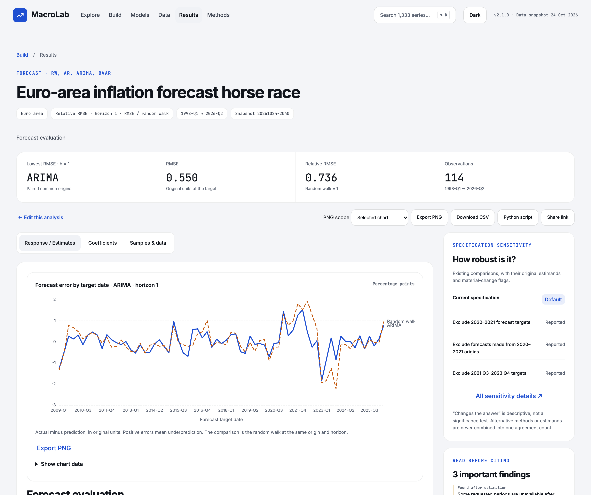
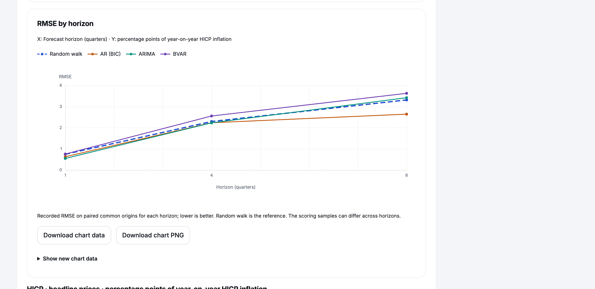
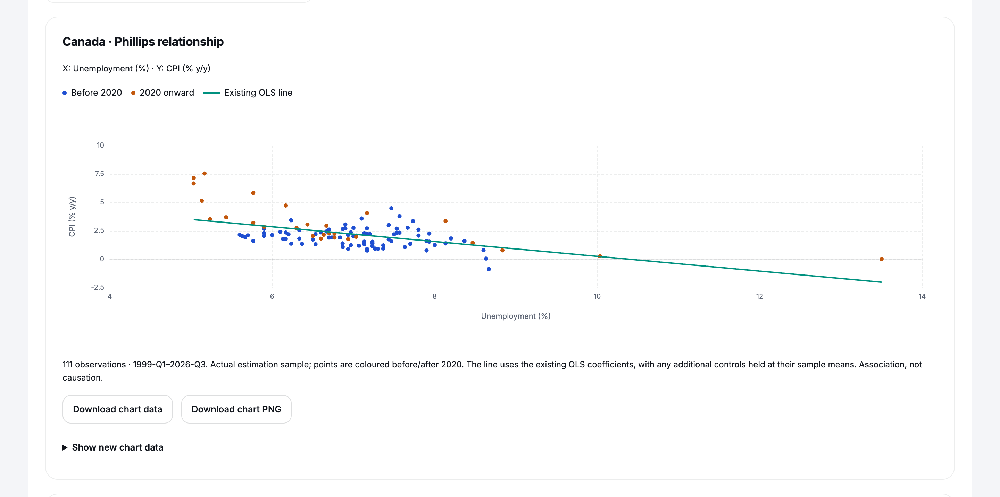
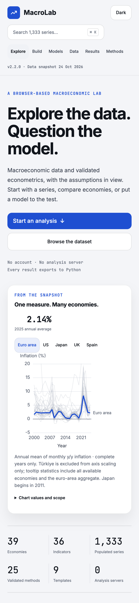
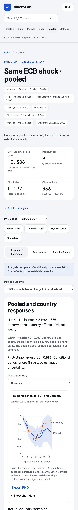

# MacroLab

Version 2.6.4.

Official macroeconomic data and validated econometrics in the browser, with assumptions, data gaps and sensitivity visible.

[Live app](https://hakangulmez.github.io/macrolab/) · [Documentation / Methods](https://hakangulmez.github.io/macrolab/#methods) · [Data licences](DATA.md)

<picture>
  <source media="(prefers-color-scheme: dark)" srcset="docs/images/home-dark.webp">
  <source media="(prefers-color-scheme: light)" srcset="docs/images/home-light.webp">
  
</picture>

## What it does

<!-- Counts verified against the shipped manifest; provenance in docs/README_MANIFEST.json. -->

- Explore **39 economies × 36 indicators** (33 national + 3 global factors), with every gap visible in the dataset explorer. Relationship scatters show the recorded sample and existing fitted line.
- Use **25 validated methods in 8 families**, from descriptive analysis to panel models and forecasting.
- Start from **9 templates**, five questions on Explore, or a **single-page custom analysis**: choose the variable of interest, other variables, the econometric model and countries. The labels adapt to regression, forecasts and shock analysis. **Simple** keeps sample and technical settings collapsed; **Advanced** opens those same settings without changing the configuration. The complete method guide remains available.
- Run entirely in the browser through **Pyodide**, with no account or analysis server. The published app uses a bundled snapshot and does not request new data from providers.
- Carry a selected series and its display transform from Data into comparison, unit-root tests or regression, or open it in Advanced. Missing inputs and incomplete choices stay visible and block execution. Export results to **CSV, PNG, LaTeX tables and reproducible Python scripts**.
- See scientific **charts and short result tables directly after running**. **Key facts** are followed by the **Econometric specification**, then relationship scatters, coefficient intervals and response curves. Warnings, units and concise samples stay visible; whole specification-sensitivity, covariance-sensitivity and detailed-evidence sections open through keyboard-accessible disclosures. Primary test results stay exposed, and opening sections never refits a model. The research workspace places the original principal chart beside its baseline estimate and descriptive robustness summary. Supporting charts stay visible in responsive grids, coefficient identifiers come first, and short coefficient tables retain every field as labelled mobile records. Every row and export remains available.

## Who it's for

MacroLab is for researchers and students exploring macroeconomic relationships,
for teaching familiar methods, and for checking how results depend on samples
and assumptions. It supports research exploration and robustness checks; it does
not replace a study's identification strategy or expert judgement.

<picture>
  <source media="(prefers-color-scheme: dark)" srcset="docs/images/workspace-dark.webp">
  <source media="(prefers-color-scheme: light)" srcset="docs/images/workspace-light.webp">
  
</picture>

## How results are validated

Calculations are cross-checked against reference implementations and independent
formulas, with stated tolerances. Simulations examine bias and interval coverage;
frozen native/browser regressions and export checks detect unintended changes.
Passing these checks does not validate an economic interpretation. See
[how methods are validated](docs/VALIDATION.md) and the [method guide](docs/METHODS.md).

## Screenshots

The research-workspace preview above shows a real local v2.6.3 result. The earlier gallery below shows real states of the local v2.6.0 build; unchanged Home and Data images retain their v2.5.0 captures. Desktop images switch with your colour-scheme preference. [Capture provenance and image sizes](docs/images/README.md).

### Dataset explorer

Germany's HICP cell is selected; its observations, coverage and source citation are shown together.

<picture>
  <source media="(prefers-color-scheme: dark)" srcset="docs/images/dataset-dark.webp">
  <source media="(prefers-color-scheme: light)" srcset="docs/images/dataset-light.webp">
  
</picture>

### Same ECB shock · pooled

Pooled and country responses use identical estimation dates. Sensitivity and the conditional-band caveat remain alongside the chart.

<picture>
  <source media="(prefers-color-scheme: dark)" srcset="docs/images/ecb-pooled-dark.webp">
  <source media="(prefers-color-scheme: light)" srcset="docs/images/ecb-pooled-light.webp">
  
</picture>

### Türkiye exchange-rate pass-through

The cumulative CPI-to-NEER response ratio is the headline measure; it is a conditional association, not a causal estimate.

<picture>
  <source media="(prefers-color-scheme: dark)" srcset="docs/images/turkiye-dark.webp">
  <source media="(prefers-color-scheme: light)" srcset="docs/images/turkiye-light.webp">
  
</picture>

### Euro-area inflation forecast horse race

Forecast errors are shown by target date; RMSE by horizon compares each model with the random-walk benchmark. Actual-versus-forecast paths, forecast errors, horizon metrics and crisis-period sensitivity are visible on the result page.

<picture>
  <source media="(prefers-color-scheme: dark)" srcset="docs/images/horse-race-dark.webp">
  <source media="(prefers-color-scheme: light)" srcset="docs/images/horse-race-light.webp">
  
</picture>

<picture>
  <source media="(prefers-color-scheme: dark)" srcset="docs/images/horse-race-rmse-dark.webp">
  <source media="(prefers-color-scheme: light)" srcset="docs/images/horse-race-rmse-light.webp">
  
</picture>

### Phillips relationship

Canada's observed inflation and unemployment pairs use the actual estimation sample. The line comes from the existing regression; the scatter does not estimate a new model or establish causation.

<picture>
  <source media="(prefers-color-scheme: dark)" srcset="docs/images/phillips-dark.webp">
  <source media="(prefers-color-scheme: light)" srcset="docs/images/phillips-light.webp">
  
</picture>

### Mobile

Home and the pooled ECB result at 375 px, also available in both themes.

<table>
  <tr>
    <td><picture>
  <source media="(prefers-color-scheme: dark)" srcset="docs/images/home-mobile-dark.webp">
  <source media="(prefers-color-scheme: light)" srcset="docs/images/home-mobile-light.webp">
  
</picture></td>
    <td><picture>
  <source media="(prefers-color-scheme: dark)" srcset="docs/images/ecb-pooled-mobile-dark.webp">
  <source media="(prefers-color-scheme: light)" srcset="docs/images/ecb-pooled-mobile-light.webp">
  
</picture></td>
  </tr>
</table>

## Templates

| Template                                | Question                                                                                 | Method                         | Default countries                            |
| --------------------------------------- | ---------------------------------------------------------------------------------------- | ------------------------------ | -------------------------------------------- |
| Monetary policy                         | How do output and prices respond to a recursive US policy-rate shock?                    | VAR · Recursive                | United States                                |
| Taylor rule                             | How is the policy rate associated with inflation and activity?                           | OLS · HAC                      | United Kingdom                               |
| Phillips curve                          | How does the inflation–unemployment relationship vary across samples?                    | OLS · Rolling                  | Canada                                       |
| Okun's law                              | How are output growth and unemployment changes related?                                  | OLS · HAC                      | Spain                                        |
| Same ECB shock                          | How do national responses differ after the same ECB shock?                               | Local projections · HC1        | Germany, France, Italy, Spain                |
| Türkiye exchange-rate pass-through      | How much exchange-rate depreciation passes through to prices?                            | Local projections · HC1        | Türkiye                                      |
| Euro-area Phillips curve · pooled       | What inflation–slack relationship emerges when euro-area countries are pooled?           | Panel FE · Driscoll–Kraay      | 11 founding euro-area members (listed below) |
| Same ECB shock · pooled                 | What is the pooled response to the same ECB shock?                                       | Panel LP · Driscoll–Kraay      | Germany, France, Italy, Spain                |
| Euro-area inflation forecast horse race | Which model predicts euro-area inflation most accurately in expanding-window evaluation? | Forecast · RW, AR, ARIMA, BVAR | Euro area                                    |

The founding-member panel comprises Austria, Belgium, Finland, France, Germany, Ireland, Italy, Luxembourg, Netherlands, Portugal, Spain.

## Data

The **20261024-2040** snapshot contains **1,404 economy–indicator cells: 1,333 populated and 71 missing**. Shared global factors appear for each economy; cells are not distinct underlying source series.

| Coverage status                                     | Cells |
| --------------------------------------------------- | ----: |
| Available                                           |   521 |
| Available with a source or methodological note      |   695 |
| Limited history, freshness or modelling suitability |   117 |
| Missing                                             |    71 |

The 7 official sources are **OECD, BIS, IMF, ECB, Eurostat, World Bank WDI and U.S. EIA**. Each series carries attribution and coverage notes. **IMF data are included for non-commercial use; Pink Sheet is excluded.** See [DATA.md](DATA.md) for source-specific permissions and restrictions. Country narratives remain withheld.

MacroLab is a **non-commercial research and teaching tool**. Source revisions and data freshness can affect results; the bundled snapshot does not update while you browse.

## How to read results

- **Only forecasting outputs are forecasts.** Other outputs are conditional associations or identified scenarios, not forecasts.
- Forecast evaluation is **pseudo-out-of-sample with final-vintage data**; real-time performance may be worse.
- **Two-sided HP gaps use later observations.** They are retrospective measures.
- **Pooled shock bands omit first-stage estimation uncertainty.** Their precision is conditional on the estimated shock.
- **ECB break-test size remains unreliable.** Do not treat its p-values as well-calibrated evidence.
- Sensitivities are descriptive; they do not remove identification or model uncertainty. Different estimands are not combined in one agreement count.

## Limitations and roadmap

Shock identification is currently recursive: the ordering supplies the
contemporaneous restrictions. MacroLab does not include high-frequency or
external-instrument shock series such as EA-MPD; adding one requires separate
approval of a new data source. The bundled data are a fixed snapshot, not a live
feed. Double/debiased machine learning for shock identification is planned and
is not an available method or a substitute for identification assumptions.

## Run locally and reproduce

Use Python 3.11, `uv`, and a Node version supported by `web/package.json`. Python and JavaScript dependencies are pinned in `uv.lock` and `web/package-lock.json`.

```sh
make setup
make quick
make test typecheck
make lint
# Compile the interface source:
cd web && npm run build
```

`make setup` retrieves dependencies from PyPI/npm with automatic Python downloads and npm lifecycle scripts disabled. `make quick` uses seeded synthetic data without network. Snapshot-dependent checks skip if their inputs are absent. The source repository does not bundle raw data, runtime binaries or private review evidence; compiling the interface alone does not prepare a runnable data snapshot.

For a self-contained calculation, download the result's **Python script**, follow its embedded environment instructions and run it locally. It carries the configuration, required input and provenance for that result. See [local build and reproduction](docs/LOCAL_BUILD.md) for the static-site inputs and [model validation cards](docs/models/README.md) for methods and limits. First-use runtime preparation takes about 8–9 seconds on the review machine; later runs reuse the worker.

## Citation

Hakan Zeki Gülmez (2026). _MacroLab_, version 2.6.4. https://github.com/hakangulmez/macrolab.

Machine-readable citation: [CITATION.cff](CITATION.cff). No DOI has been assigned.

## Licence

Code: [MIT](LICENSE). **Data and data-derived outputs are not covered by the MIT licence; see [DATA.md](DATA.md).** Fonts use the SIL Open Font License (OFL); other software retains its own terms. See [software notices](docs/SOFTWARE_NOTICES.md) and [runtime notices](third_party/runtime/SOURCE_AVAILABILITY.md).
